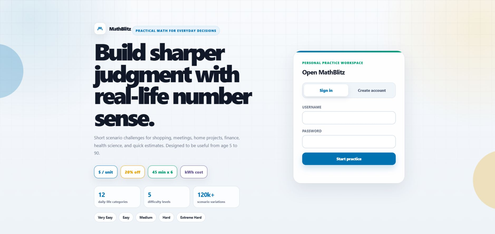
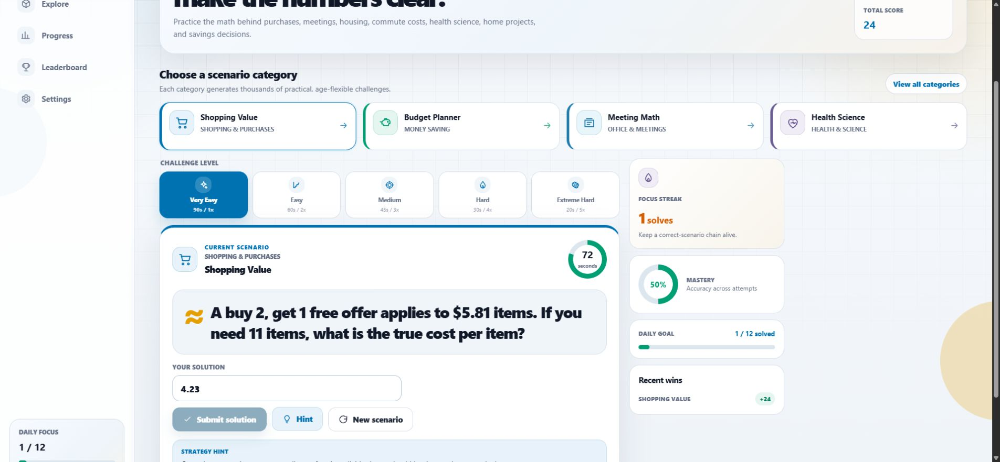
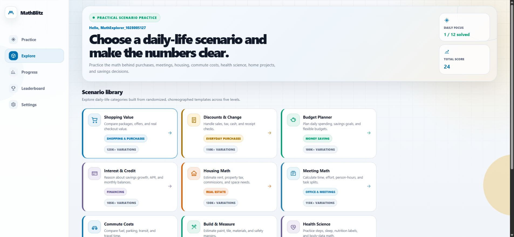

# MathBlitz

### Practical math for everyday decisions

MathBlitz turns the numbers behind everyday life into short, interactive challenges: comparing grocery prices, planning savings, understanding interest, measuring a room, checking a utility bill, and making better use of meeting time.

A responsive browser interface and a native Android client share one versioned FastAPI backend. Code-defined scenario templates provide randomized practice across **12 real-world categories** and **five difficulty levels**, with server-checked answers, strategy hints, saved progress, and a leaderboard.

**No Streamlit. No external AI service or API key required. No frontend build step.**

[Quick Start](#quick-start) | [Scenarios](#scenario-library) | [User Journey](#the-end-to-end-flow) | [Architecture](#architecture) | [API](#rest-api) | [Android](#android-app) | [Testing](#testing-and-verification)



*Actual application screenshot captured locally on October 28, 2026. Workspace screenshots below use a disposable demo account, not personal user data.*

## The Problem

Everyday decisions often involve useful math hidden inside an ordinary task:

- A larger package is not necessarily the better deal after unused portions are considered.
- Two successive discounts are not the same as adding their percentages.
- A short meeting consumes the combined time of everyone attending.
- A monthly payment difference adds up over years, but is not a complete rent-versus-buy analysis.
- A recipe, room, or electricity bill requires converting units before calculating a result.

MathBlitz focuses on these practical situations rather than disconnected arithmetic worksheets. The aim is to make frequent, approachable number practice useful to people with different interests and confidence levels. It is a practice tool, not a certified cognitive-health intervention or a professional decision engine.

## Who It Is For

| Audience | Useful practice |
| --- | --- |
| Families and younger learners, with adult guidance | Change, sharing, servings, steps, and familiar quantities |
| Students and math-puzzle enthusiasts | Ratios, percentages, estimation, and multi-step reasoning |
| Professionals and office teams | Person-hours, task allocation, commute costs, and budgets |
| Homeowners, renters, and DIY enthusiasts | Space requirements, commissions, property tax, paint, and flooring |
| Educators and math professors | Concrete starting points for explaining assumptions and discussing trade-offs |
| Older adults and casual daily users | Short, repeatable practice with real-life contexts |

The product direction is age-inclusive, but difficulty levels are **not age-calibrated or validated for ages 5-90**. Current tasks are timed and require reading; some contexts remain more suitable for adults. The existing terms specify a minimum self-registration age of 13, and parental-consent controls are not implemented.

## Project Snapshot

| Area | Current implementation |
| --- | --- |
| Browser client | Responsive HTML, CSS, vanilla JavaScript, and inline SVG icons |
| Android client | Native Java client using the same HTTP API |
| Backend | FastAPI, versioned REST endpoints, generated OpenAPI schema |
| Durable storage | SQLAlchemy models; SQLite by default |
| Shared caching | Optional Redis; local in-memory fallback |
| Practice content | 12 category generators, five levels, numeric and two-option answers |
| Feedback | Hints, correct/incorrect/timeout outcomes, points, accuracy, recent attempts |
| Identity | Username/password registration, scrypt hashes, signed expiring bearer tokens |
| Verification | Focused pytest domain, API, security, and legacy-compatibility tests |
| Status | Runnable local application; production hardening and Android device validation remain |

### Practice Workspace



The workspace combines the scenario, level, countdown, answer controls, hints, and recent results. The example above shows an actual buy-two-get-one-free calculation submitted through the API.

### Explore View



The library provides a separate exploration view beyond the featured categories. Variation labels in the interface are catalog estimates, as explained below.

## Scenario Library

| Category | Scenario families | Skills | API activity ID |
| --- | --- | --- | --- |
| Shopping Value | Unit prices, buy-two-get-one-free offers, package quantities and excess servings | Division, comparison, rounding up | `shopping-value` |
| Discounts & Change | Cash change, successive discounts, sales tax | Addition, subtraction, percentages | `discounts-change` |
| Budget Planner | Daily allowances, savings targets, spending after bills and savings | Division, budgeting, percentages | `budget-planner` |
| Interest & Credit | Simple interest, annual compounding, one-month credit balances | Rates, growth, balance calculations | `interest-credit` |
| Housing Math | Bedroom proportions, split commissions, rent/mortgage differences, property tax | Proportions, percentages, time horizons | `housing-real-estate` |
| Meeting Math | Person-hours, late arrivals, work ratios, shared workloads | Elapsed time, units, allocation | `office-meetings` |
| Commute Costs | Fuel spending, parking/transit comparisons, travel time | Rates, distance, recurring costs | `commute-costs` |
| Build & Measure | Paint coverage, tiles with waste allowance, simplified bracket counts | Area, units, rounding, margins | `build-measure` |
| Health Science | Steps, nutrition-label scaling, sleep duration, rough heart-rate arithmetic | Subtraction, proportions, time | `health-science` |
| Recipe Scaling | Ingredients, cost per serving, whole-pan quantities | Ratios, unit cost, rounding up | `recipe-scaling` |
| Home Utilities | Electricity cost, water use, bill increases | Energy units, rates, percentages | `home-utilities` |
| Quick Estimates | Pizza areas, rough apartment-sampling rules, household water estimates | Geometry, estimation, assumptions | `quick-estimates` |

### Worked Examples

These illustrate supported scenario families; generated numbers vary on each task.

| Situation | Reasoning | Result |
| --- | --- | --- |
| 12 oz costs $3.60; 16 oz costs $4.48 | Compare $3.60 / 12 with $4.48 / 16 | Second package: $0.28/oz versus $0.30/oz |
| A $40 item has 25% off, then another 10% off | $40 x 0.75 x 0.90 | $27.00, not $26.00 from a single 35% discount |
| Keep $10 from a $70 budget lasting seven days | ($70 - $10) / 7 | About $8.57/day |
| Six people attend a 45-minute meeting | 6 x 45 / 60 | 4.5 person-hours |
| A 10 ft by 14 ft room needs 12-inch square tiles and 10% extra | 140 x 1.10; round up | 154 tiles |
| An appliance draws 1,000 W for four hours at $0.20/kWh | (1,000 / 1,000) x 4 x $0.20 | $0.80 |

### Randomized And Choreographed Content

Each generator selects from code-defined scenario families, varies quantities and rates, computes an expected answer, and supplies an approach hint. Difficulty can change number ranges, available branches, or calculation steps.

Here, **choreographed** means deliberately structured templates. It does **not** mean a personalized learning sequence, adaptive curriculum, or AI-generated narrative.

The original content goal is roughly 10,000 variations per category across five levels. The catalog declares estimates of 100,000-130,000 variations per category. These are **metadata estimates, not an enumerated or exhaustively audited puzzle bank**. Tests check generation and declared estimates, not uniqueness of 10,000 prompts per category. Repeated scenarios, equivalent calculations, and ties can occur. Deduplication and a full content-quality audit remain roadmap items.

Generators accept an injected `random.Random` instance for reproducible tests. The public task API does not expose a seed parameter.

## Difficulty And Scoring

| Level | Server time limit | Multiplier | Base points when correct | Intended progression |
| --- | --- | --- | --- | --- |
| Very Easy | 90 seconds | 1x | 10 | Friendly numbers and introductory reasoning |
| Easy | 60 seconds | 2x | 20 | Short calculations with common values |
| Medium | 45 seconds | 3x | 30 | Everyday multi-step reasoning |
| Hard | 30 seconds | 4x | 40 | Larger numbers and less obvious operations |
| Extreme Hard | 20 seconds | 5x | 50 | Faster multi-step calculation |

```text
correct-answer points = (10 x level multiplier)
                      + floor(max(0, time limit - elapsed seconds) / 5)
incorrect or timed-out answer = 0 points
```

The backend owns the deadline and scoring; changing a browser countdown does not extend task expiration. Currency and decimal answers allow an absolute difference of up to `0.01`; integer and choice answers require an exact match. Many non-currency generator outputs are rounded to one decimal place.

Progress includes total attempts, score, accuracy, average response time, a recent correct-answer streak, and correct answers today. The daily goal is 12 correct answers. Daily aggregation uses UTC. The streak counts consecutive correct results within the latest 40 attempts; it is not a consecutive-calendar-day streak.

## The End-to-End Flow

1. **Open the app.** FastAPI serves the browser client and assets; Android connects to the same backend separately.
2. **Register or sign in.** The API validates credentials, hashes new passwords with scrypt, and returns an expiring signed bearer token.
3. **Choose a category and level.** The client loads the public catalog and the user's saved preferences.
4. **Request a scenario.** A generator creates a task; the service stores a user-owned session containing its answer and expiration.
5. **Solve the problem.** The client displays the prompt, answer controls, countdown, and optional hint. The issue response does not include the answer.
6. **Submit once.** The server checks ownership, prior submission, deadline, and answer policy, then records the outcome. A database uniqueness constraint also prevents duplicate attempts.
7. **Receive feedback.** The response includes the correct answer, result status, points, and elapsed duration.
8. **Review progress.** Dashboard and leaderboard queries aggregate durable attempts, using short-lived caches for repeat reads.
9. **Return later.** History and preferences remain in the database. Browser tokens use session storage; Android maintains local client settings.

## Architecture

MathBlitz is a **layered modular monolith**, not a collection of microservices. It separates presentation, HTTP transport, application use cases, domain rules, and persistence while keeping local deployment small.

```text
Responsive web client             Native Android client
          |                                |
          +--------- HTTP /api/v1 ----------+
                           |
               FastAPI routes and validation
                           |
          Authentication / practice / preference services
                     |                 |
              Domain strategies    Repositories and cache port
                                       |           |
                              SQLAlchemy DB     Redis or memory
```

| Boundary | Responsibility | Main location |
| --- | --- | --- |
| Presentation | Screens, icons, form state, countdown rendering, API calls | `frontend/`, `android/` |
| HTTP | Contracts, authentication dependencies, HTTP statuses | `mathblitz/api/`, `mathblitz/schemas.py` |
| Application | Register/login, issue/submit task, progress, preferences | `mathblitz/services.py` |
| Domain | Generator contract, scenarios, levels, answer/scoring policy | `mathblitz/domain/` |
| Persistence | Models, query adapters, sessions, legacy import | `mathblitz/db/` |
| Infrastructure | Settings, security helpers, cache adapters, composition root | `mathblitz/core/` |

### SOLID-Informed Design

- **Single responsibility:** HTTP validation, scoring, generation, and database queries live in distinct modules.
- **Open/closed:** New categories implement `ActivityGenerator` and register an `ActivitySpec` without rewriting task submission.
- **Liskov substitution:** Generators share the `GeneratedTask` contract; memory and Redis adapters share the cache contract.
- **Interface segregation:** Generators and cache consumers use focused interfaces rather than one all-purpose infrastructure object.
- **Dependency inversion:** Domain rules avoid FastAPI/SQLAlchemy dependencies, and caching uses an injected abstract port. Queries are isolated behind concrete repository adapters; repository interfaces are not yet fully abstracted.

Android currently concentrates screens and orchestration in one `MainActivity`. Further modularization is a next step, not a completed clean-architecture claim. See [Architecture](docs/ARCHITECTURE.md) for supporting notes.

## Database Design

| Table | Stored data | Important constraints and indexes |
| --- | --- | --- |
| `users` | UUID, display/canonical username, password hash, creation time | Unique case-folded username |
| `user_preferences` | Default category, level, sound setting | One row per user; difficulty check |
| `task_sessions` | User, category, level, prompt, hint, answer mode, protected answer, context, timestamps | User foreign key; user/creation-time and expiration indexes |
| `attempts` | Task/user, submitted answer, outcome, points, duration, submission time | Unique task ID; result/level checks; user/time and category/level indexes |

A user has one preference row and many task sessions. A task can have at most one attempt. Separating issued tasks from submitted attempts supports protected answers, server deadlines, and durable results.

SQLite defaults to `data/mathblitz.db`; SQLAlchemy creates missing tables at startup. PostgreSQL-compatible reference DDL is in [`migrations/001_initial.sql`](migrations/001_initial.sql), but there is no automated versioned migration runner. A matching PostgreSQL driver must be installed separately to use a PostgreSQL URL. See [Database Design](docs/DATABASE.md).

## Redis And Scaling

Redis stores ephemeral state, not the source of truth:

- Failed-login counters keyed by client IP and case-folded username.
- Dashboard summaries per user.
- Leaderboard results per requested limit.

Without reachable Redis at startup, the app uses a thread-safe process-local memory adapter. This keeps development self-contained but does not provide shared throttling or coherent caches across workers. A Redis failure after startup has no general runtime failover mechanism.

The intended shared-deployment direction is multiple API workers behind a TLS reverse proxy, PostgreSQL for durable storage, and Redis for shared counters/caches. Static assets can be delivered separately. This structure is **not** a deployed or load-tested cluster included in the repository.

Current operational considerations:

- Only the default top-10 leaderboard cache is explicitly invalidated after submission; other limits can remain stale until their TTL expires.
- No scheduled cleanup worker removes abandoned task sessions.
- Schema changes need a release migration process; `create_all` does not evolve existing tables.
- Backups, metrics, tracing, request-wide rate limits, pool tuning, and capacity testing remain deployment work.

## Technology Stack

| Layer | Technology |
| --- | --- |
| API | Python, FastAPI, Pydantic, Uvicorn |
| Persistence | SQLAlchemy 2.x, SQLite; optional PostgreSQL with an added driver |
| Cache | redis-py/Redis, or in-process memory |
| Web | HTML5, CSS Grid/Flexbox, vanilla JavaScript, inline SVG |
| Android | Java, Android SDK platform APIs, direct PowerShell build |
| Tests | pytest, HTTPX/FastAPI TestClient |
| Security primitives | Standard-library scrypt, random salts, HMAC-SHA256 |

Dependency ranges are in [`requirements.txt`](requirements.txt). No Node package install, frontend bundler, hosted AI dependency, or Streamlit runtime is required.

## Quick Start

### Prerequisites

- Git and Python. Python 3.11+ is a reasonable development baseline; local verification used Python 3.14.2.
- A modern browser.
- Redis/PostgreSQL are optional for a single-process local run.
- Node.js is optional, needed only for the JavaScript syntax check below.

### Windows PowerShell

```powershell
git clone https://github.com/vams2krish/MathBlitz.git
cd MathBlitz
python -m venv .venv
.\.venv\Scripts\python.exe -m pip install -r requirements.txt
.\.venv\Scripts\python.exe app.py
```

Using the virtual environment's Python directly avoids requiring activation-script changes.

### macOS Or Linux

```bash
git clone https://github.com/vams2krish/MathBlitz.git
cd MathBlitz
python3 -m venv .venv
.venv/bin/python -m pip install -r requirements.txt
.venv/bin/python app.py
```

| Resource | Local URL |
| --- | --- |
| Browser app | http://127.0.0.1:8000/ |
| Swagger UI route (see troubleshooting) | http://127.0.0.1:8000/docs |
| OpenAPI schema | http://127.0.0.1:8000/openapi.json |
| Database/cache health | http://127.0.0.1:8000/api/v1/health |

Create a local account, choose a scenario, and submit a solution. Stop the foreground development server with `Ctrl+C`.

## Configuration

Settings come from the process environment. [`.env.example`](.env.example) is a reference; simply creating `.env` does **not** load it when running `python app.py`.

| Variable | Default | Purpose |
| --- | --- | --- |
| `MATHBLITZ_DATABASE_URL` | `sqlite:///./data/mathblitz.db` | SQLAlchemy connection URL |
| `MATHBLITZ_REDIS_URL` | Unset | Optional Redis connection URL |
| `MATHBLITZ_SECRET_KEY` | Fixed local-development value | Token signing; replace outside local development |
| `MATHBLITZ_ACCESS_TOKEN_MINUTES` | `480` | Token lifetime in minutes |
| `MATHBLITZ_CACHE_TTL_SECONDS` | `30` | Summary cache lifetime |

Set values before starting, for example:

```powershell
$env:MATHBLITZ_SECRET_KEY = '<your-long-random-secret>'
$env:MATHBLITZ_REDIS_URL = 'redis://127.0.0.1:6379/0'
.\.venv\Scripts\python.exe app.py
```

To explicitly load an environment file with the installed Uvicorn tooling:

```powershell
.\.venv\Scripts\python.exe -m uvicorn app:app --env-file .env --host 127.0.0.1 --port 8000
```

Do not commit real secrets or database credentials. The fixed local secret, SQLite storage, and reload server are not a production configuration.

## REST API

Routes below are rooted at `/api/v1`. Authenticated calls use `Authorization: Bearer <access_token>`.

| Method | Route | Auth | Purpose |
| --- | --- | --- | --- |
| `GET` | `/health` | Public | Database connectivity and selected cache status |
| `POST` | `/auth/register` | Public | Create account and return credentials |
| `POST` | `/auth/login` | Public | Sign in with failed-login throttling |
| `GET` | `/activities` | Public | Categories, icons, declared estimates, levels |
| `POST` | `/tasks` | Bearer | Issue a timed scenario without its answer |
| `POST` | `/tasks/{task_id}/submissions` | Bearer | Record an answer and return feedback |
| `GET` | `/me/dashboard` | Bearer | Summary and recent attempts |
| `GET` | `/me/preferences` | Bearer | Read defaults |
| `PATCH` | `/me/preferences` | Bearer | Update defaults and sound preference |
| `GET` | `/leaderboard?limit=10` | Public | Ranked results; limit is 1-100 |

### Example Task Exchange

After signing in through `/api/v1/auth/login` or the client:

```http
POST /api/v1/tasks
Authorization: Bearer <access_token>
Content-Type: application/json

{
  "activity_id": "discounts-change",
  "difficulty": "Medium"
}
```

The response includes `id`, category information, `difficulty`, `prompt`, `hint`, `answer_mode`, `time_limit_seconds`, and `expires_at`. It omits `correct_answer`.

Use the returned ID and your answer before expiration:

```http
POST /api/v1/tasks/<returned-task-id>/submissions
Authorization: Bearer <access_token>
Content-Type: application/json

{
  "answer": "27.00"
}
```

`27.00` is an example, not every generated task's answer. Decimal strings are accepted. Feedback includes the outcome, correct answer, points, and duration.

| Status | Typical meaning |
| --- | --- |
| `200` | Successful read, login, or preference update |
| `201` | Account, task, or attempt created |
| `401` | Missing, invalid, or expired credentials |
| `404` | Unknown category or task not owned by caller |
| `409` | Duplicate username or already-submitted task |
| `422` | Invalid payload, username, or level |
| `429` | Too many failed sign-in attempts |

Tokens use an application-specific HMAC format, **not standard JWTs**. See [API Design](docs/API.md) and `/openapi.json` for contracts. FastAPI exposes Swagger UI at `/docs`, but the current application-wide content security policy can block its CDN and inline assets; interactive documentation needs a scoped policy or self-hosted assets before relying on that interface.

## Android App

[`android/`](android/) contains a native client, not a WebView wrapper: account access, category catalog, five levels, timed tasks, hints, submission, progress/leaderboard views, preferences, and an API URL setting. Layout decisions use screen width and orientation for phone/tablet presentations.

### Build A Debug APK

The current build path uses Windows PowerShell and requires:

- A JDK with `javac`, `jar`, and `keytool`, available through `JAVA_HOME` or the detected Java installation.
- Android SDK platform files and build-tools with `aapt2`, `zipalign`, and `apksigner`.
- D8 at the expected path: `cmdline-tools/latest/bin/d8.bat`.
- `ANDROID_HOME` or `ANDROID_SDK_ROOT` when the SDK is not under `%LOCALAPPDATA%\Android\Sdk`.

```powershell
cd android
.\build.ps1
adb install -r .\build\mathblitz-debug.apk
```

Output: `android/build/mathblitz-debug.apk`. Build outputs and the debug keystore are ignored by Git. There is no committed APK, Gradle wrapper, Play Store package, or release-signing pipeline.

### Connect To The Backend

| Device | API address |
| --- | --- |
| Standard Android emulator | `http://10.0.2.2:8000` (default) |
| Physical device on the same network | `http://<computer-LAN-address>:8000` |

For physical-device access on a trusted local network:

```powershell
.\.venv\Scripts\python.exe -m uvicorn app:app --host 0.0.0.0 --port 8000
```

Allow access only from intended devices. `0.0.0.0` is a listening address, not the address entered in the app. The URL setting currently lives inside the signed-in workspace; a fresh physical-device install may need its initial base URL configured in `MainActivity.java` before building.

The manifest permits cleartext HTTP for local development. Use HTTPS and review network/backup/token-storage settings before distribution. The debug script recreates its signing key on every build, so replacing an installation may require uninstalling it first, removing local client settings.

**Verification boundary:** debug APK compilation and signature verification have succeeded. Native navigation, layout behavior, accessibility, and API interactions have not been verified on an emulator or physical device. Build success is not a claim of store/device readiness.

More details: [Android README](android/README.md).

## UI And Accessibility Direction

- Restrained blue, teal, orange, purple, and neutral colors instead of neon accents.
- Icons, text labels, and explicit results so meaning is not carried by color alone.
- Labeled inputs, semantic buttons, status/alert regions, and visible keyboard focus styling.
- Web breakpoints at 1180 px, 820 px, and 520 px, with reorganized navigation and stacked content.
- Dedicated two-option comparisons and decimal-friendly numeric input.
- Separate practice, exploration, progress, leaderboard, and settings views.

This is a color-blind-friendly design direction, **not a completed WCAG or assistive-technology audit**. Reduced-motion handling, untimed practice, consistent small-screen accessible names, and cross-device validation remain improvement areas.

## Testing And Verification

From the repository root:

```powershell
.\.venv\Scripts\python.exe -m pytest -q
```

Additional checks:

```powershell
.\.venv\Scripts\python.exe -m compileall mathblitz app.py
node --check frontend\assets\app.js
```

The focused suite covers:

- Level names, time limits, score policy, and decimal answer tolerance.
- Seeded generation across all categories and levels, catalog shape, and declared estimates.
- Answer privacy, duplicate submissions, and timeouts.
- Preferences, dashboard results, and leaderboard aggregation.
- Failed-login throttling and response security headers.
- Salted passwords, token tamper rejection, and legacy level-name translation.

### Verification Snapshot

On October 28, 2026, the existing suite completed with **17 tests passing**. A local browser walkthrough also verified sign-in, catalog loading, scenario issue, a correct answer submission, a saved score update, and the scenario-library view. The three screenshots in this README came from that live application, not design mockups.

These tests are not exhaustive mathematical proofs or a 10,000-unique-puzzle audit. Redis/PostgreSQL deployment behavior, concurrent load, browser end-to-end automation, Android instrumentation, and device accessibility are not covered by the existing suite.

## Legacy Data Migration

The previous `data/users.json` and `data/progress/*.csv` files remain untouched. To import compatible records into the configured relational database:

```powershell
.\.venv\Scripts\python.exe -m scripts.migrate_legacy_data
```

Back up the source files and destination database first. The importer reports progress records without a matching user. Compatible legacy passwords upgrade to scrypt after successful sign-in, and legacy level/category names are normalized where supported.

## Repository Layout

```text
MathBlitz/
  app.py                         Development entry point
  requirements.txt               Python dependency ranges
  .env.example                   Configuration reference
  mathblitz/
    main.py                      App factory, SPA hosting, middleware
    schemas.py                   Public request/response contracts
    services.py                  Application use cases
    api/                         Versioned routes and dependencies
    core/                        Settings, security, cache, composition
    db/                          Models, repositories, sessions, legacy import
    domain/                      Generators, difficulty, scoring
  frontend/
    index.html                   Browser app shell
    assets/                      JavaScript and CSS
  android/
    app/src/main/                Native Java client and resources
    build.ps1                    Direct SDK debug build
  migrations/001_initial.sql     PostgreSQL-compatible schema reference
  scripts/migrate_legacy_data.py Legacy import command
  tests/                        Focused automated tests
  docs/                         Architecture, API, database notes, screenshots
  data/                         Local database and legacy data
```

## Security, Privacy, And Safety

Implemented protections include salted scrypt hashes, expiring signed tokens, task ownership checks, one-attempt constraints, validated payloads, failed-login throttling, and security headers including a restrictive content security policy.

Important boundaries:

- Usernames and aggregate results appear on the public leaderboard. Avoid sensitive real-world identifiers in demo accounts.
- The server stores account, preference, task, and attempt data. This is **not client-only or entirely offline**.
- Browser tokens use session storage. Refresh tokens, revocation, password reset, account deletion, and data-export APIs are not implemented.
- Registration/global API throttling and review of the custom token format remain production work.
- Finance, housing, health, and engineering tasks use simplified assumptions for arithmetic practice, not professional advice. Do not use generated answers for medication dosing or real load-bearing decisions.
- The [Privacy Policy](privacy_policy.md) and [Terms of Service](terms_of_service.md) are legacy documents that do not fully describe this server-backed version. Owner review is needed before public deployment, especially for retention and younger users.

## Troubleshooting

| Symptom | Check |
| --- | --- |
| Browser cannot connect | Keep the server running and use its reported port |
| `/health` opens the app shell | Use `/api/v1/health`; other paths use the SPA fallback |
| Redis configured but health reports `memory` | Check startup connectivity, correct it, and restart |
| PostgreSQL URL fails | Install the matching driver and validate its URL |
| `.env` changes do nothing | Export variables or explicitly use Uvicorn's `--env-file` |
| `/docs` is blank or reports blocked assets | The current CSP blocks Swagger's external/inline assets; use `/openapi.json` or adjust documentation hosting/policy |
| Cannot resubmit a completed task | Each task permits one attempt; request a new scenario |
| Android cannot reach `127.0.0.1` | Use emulator address `10.0.2.2` or the host's LAN address |
| Android build fails | Check SDK/JDK environment variables and required tools, including D8 |
| Android reinstall signature mismatch | Uninstall the previous debug app before installing the newly signed build |
| Scoreboard briefly stale | Summary reads are cached; non-default leaderboard limits may wait for TTL expiry |

## Roadmap

- Audit ambiguity, ties, rounding instructions, and difficulty calibration with broader content tests.
- Measure unique coverage; add repetition control, curated daily sets, and progressive practice paths.
- Add untimed modes, broader currencies/units, and reading-level adjustments.
- Modularize Android state/screens and add emulator, device, and accessibility tests.
- Add persistent release signing, explicit Android SDK targeting, and reproducible mobile releases.
- Introduce versioned migrations, task-session cleanup, complete cache invalidation, and monitoring.
- Add account lifecycle controls, update privacy/terms, and define safeguards for younger audiences.
- Add CI, Redis/PostgreSQL integration tests, browser end-to-end tests, and load testing.

## Contributing

Use [GitHub Issues](https://github.com/vams2krish/MathBlitz/issues) for reproducible bugs or scenario suggestions. Include the category, level, exact prompt, expected reasoning, and rounding assumptions without publishing personal account data.

For a new category, implement the generator contract, register metadata, supply an appropriate icon, and add focused deterministic tests. Keep presentation logic out of the domain layer and run the suite before proposing a change.

## License And Documentation

No standalone `LICENSE` file is included. Public repository visibility does not itself grant an open-source license; reuse terms need clarification by the owner.

- [Architecture](docs/ARCHITECTURE.md)
- [REST API](docs/API.md)
- [Database Design](docs/DATABASE.md)
- [Android Client](android/README.md)
- [Issue Tracker](https://github.com/vams2krish/MathBlitz/issues)

**MathBlitz: short practical challenges, clearer everyday number sense.**
